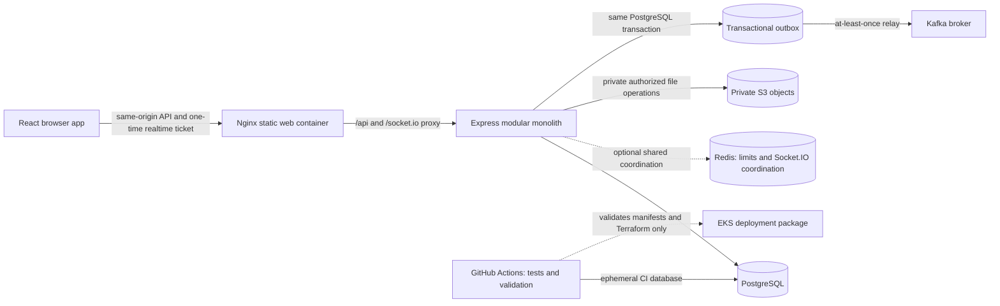

# TeamVault portfolio overview

TeamVault is a multi-tenant collaboration application built as a modular monolith. It demonstrates how a small product can keep workspace authorization and PostgreSQL transactions authoritative while adding browser collaboration, private file handling, durable asynchronous events, and a path to containerized deployment.

## Product walkthrough

Use the local browser app to demonstrate these implemented flows:

1. Register an account, sign in, sign out, and revisit a protected route while logged out.
2. Create a workspace, add an existing user, review membership roles, and open a second account that belongs to a different workspace.
3. Create and edit a project, create tasks, set their status/priority/assignee/due date, and see stale updates rejected.
4. Read and post project/task comments, then inspect the workspace activity feed.
5. Upload, list, download, and delete an allowed file through the API. Local browser E2E uses an in-memory object-store double; it does not demonstrate a live S3 integration.
6. Keep a second authorized workspace member open while posting a change and observe best-effort Socket.IO refresh hints. Signing out invalidates the browser session and the realtime ticket.

The browser UI is connected to the existing APIs; it does not seed fake product records. The documented browser E2E workflow exercises the complete local product path against the dedicated `teamvault_m3_review` database.

## Architecture

The API, worker, and migration job are separate runtime roles of the same application package. Modules communicate in process and share PostgreSQL. The diagram's AWS and managed-service boxes describe integration boundaries and configuration, not a deployed environment.

## Security properties and limits

- Browser sessions use HttpOnly cookies; browser code does not persist session tokens in local storage or put them in URLs. Cookie-authenticated mutations validate the configured web origin. Socket connections use short-lived single-use tickets, then recheck session and workspace membership.
- Tenant-owned API reads and writes verify workspace membership and include workspace scope in database operations. E2E attempts cross-workspace project/file access and confirms denial.
- File metadata and bytes are served only through authorized API calls; server-generated object keys are not sent to the browser. The browser test uses an in-memory fake object store.
- Activity and outbox records use allowlisted resource identifiers and metadata rather than comment text or resource descriptions. Outbox delivery is at least once; future consumers must deduplicate stable event IDs.
- PostgreSQL remains the source of truth. Socket.IO updates are hints and can be missed while disconnected; clients must reload from the APIs. Redis fallback to per-process behavior weakens aggregate login limiting and cross-instance realtime coordination.
- The request logger emits only request ID, method, route template, status, and duration. It excludes the full URL, query, client IP, headers, cookies, bodies, and resource values.

See [SECURITY.md](SECURITY.md) for test boundaries and known security follow-up work.

## Verification and evidence

The maintainers should report command output from the specific review run rather than presenting these checks as permanent service guarantees. The automated checks include API unit and PostgreSQL integration suites, React component tests, Playwright browser E2E, production builds, dependency checks, Terraform formatting/validation without a backend, and Kubernetes manifest rendering.

The included k6 scenario is a one-minute, five-request-per-second health-path smoke test. It is not an authenticated workload benchmark, an SLO, or a capacity result. No throughput or uptime achievements are claimed here.

## Integrations not represented as verified

- Terraform has been formatted and validated locally; it has not been planned/applied to AWS.
- EKS manifests have been rendered locally; there has been no cluster rollout, ALB health check, or rollback exercise.
- No live AWS, S3, Google OAuth, Kafka broker, production Redis cluster, managed secret synchronization, or central application log pipeline has been exercised in this review.
- GitHub Actions workflow syntax was parsed locally, but a hosted GitHub Actions run has not yet occurred.
- The k6 scenario has not been run, so there are no performance measurements.
- There is no client-side replay cursor for realtime events; disconnected clients may miss updates.

Do not provision cloud infrastructure or incur cloud costs without a separately reviewed resource-by-resource estimate and explicit approval.
